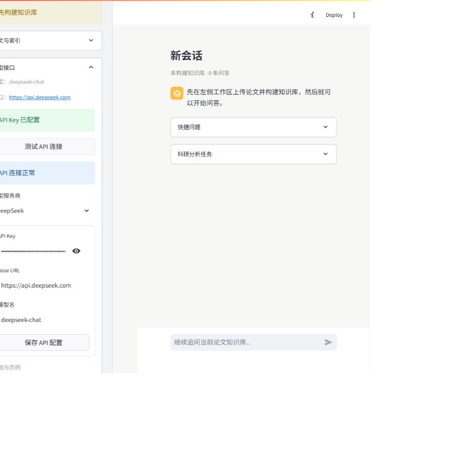
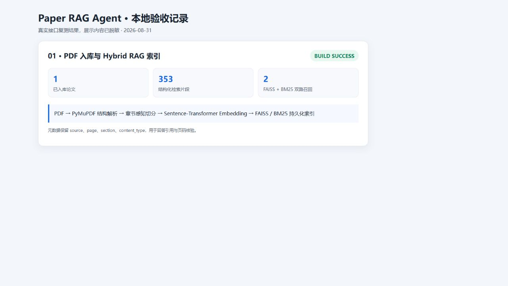
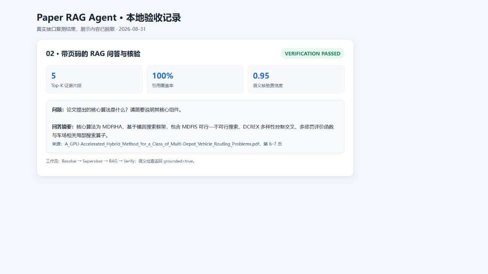
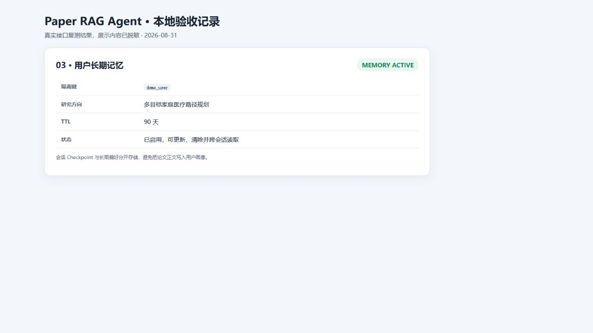
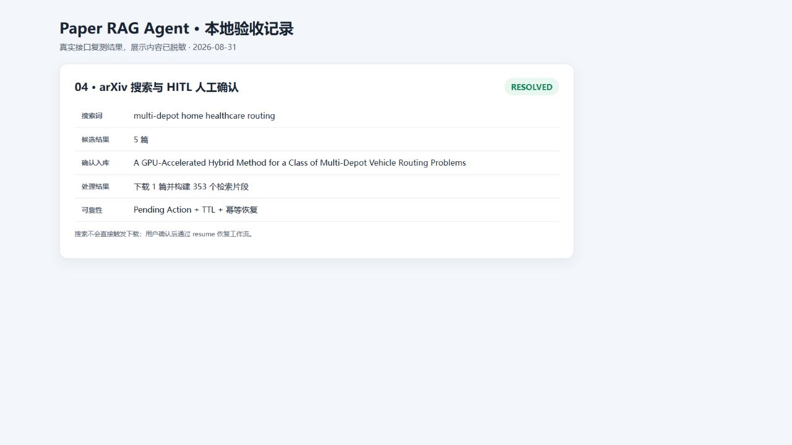

# paper-rag-agent

面向科研阅读与方法复现的 Skill + Agent Harness 论文检索、PDF 解析、Hybrid RAG 问答与引用核验系统。

项目将论文发现、结构化解析、向量入库、混合检索、科研分析和来源核验组织为可恢复的工作流。重点不只是调用大模型，而是让回答尽量建立在可追溯的论文页码、表格和图片说明上。

## Highlights

- **科研 Agent Harness**：独立运行受预算约束的模型决策、Skill 选择、工具执行和完成检查循环，支持人工确认后的原任务继续、任务快照恢复与执行轨迹。详见 [Harness 架构与接口](docs/HARNESS.md)。
- **论文发现与阅读工作台**：按关键词、年份、来源和已核实论文类型查询；跨来源去重、展示筛选理由，支持收藏、批量下载 arXiv PDF、证据精读卡片和多论文对比表。

- **Skill + Harness 编排**：论文发现、证据阅读与科研写作使用仓库内受信任 Skill；工具权限由代码校验，状态循环由独立 Harness 直接执行。
- **MCP 工具扩展**：使用官方 Python SDK 构建独立 MCP Server，通过 stdio 暴露 arXiv、OpenAlex、Crossref 检索与受控 PDF 下载工具；客户端支持工具发现、Schema 校验、缓存、超时与自动重连。
- **结构感知 PDF 解析**：基于 PyMuPDF 识别章节、页码、表格和嵌入图片，将表格转换为 Markdown，并关联图注与附近正文。
- **Hybrid RAG 检索**：Sentence-Transformer Dense Retrieval 与 BM25 混合召回，结合内容类型、章节和问题意图进行规则重排。
- **引用可追溯回答**：回答提示词要求标明论文文件名与页码；Verify 节点检查回答引用是否来自本轮检索证据。
- **状态与会话管理**：Harness 按 `user_id:session_id:run_id` 原子保存任务快照；应用层保存会话、索引、审批和报告。
- **可降级运行**：未配置大模型 API 时仍可完成 PDF 解析、索引构建和证据检索，便于本地调试。
- **可恢复 HITL 与长期记忆**：搜索结果确认带 TTL 和幂等恢复；用户偏好按 `user_id` 隔离，可开关、设置 TTL 和清除。
- **双入口交互**：同时提供 Streamlit 页面与 FastAPI/SSE 接口，支持上传、对话、审批恢复和记忆管理。
- **测试覆盖**：自动化测试覆盖节点路由、结构化澄清、MCP 工具发现与调用、引用归一化、记忆隔离、审批幂等、论文发现与收藏、API、图表处理、结构化切分与标准检索指标。
- **可复现检索评测**：提供30篇语料清单、开发/测试集隔离、BM25/Dense/Hybrid消融，以及文档级和证据Chunk级Recall@K、Hit@K、MRR与延迟统计，详细结果见 `evaluation/RESULTS.md`。
- **可选高精度重排**：通过 `RETRIEVAL_MODE="hybrid_llm_rerank"` 对第一阶段Top-20候选执行LLM精排；独立盲测文档级Recall@5为92.9%，默认仍使用低延迟Hybrid模式。

## Why This Project Matters

| 能力点 | 项目中的体现 |
| --- | --- |
| Agent workflow engineering | 使用 Skill 注册表、预算循环、工具白名单和原子任务快照编排科研任务 |
| Retrieval engineering | FAISS Dense + BM25 混合召回，并按章节、内容类型和问题意图重排 |
| Document intelligence | 解析正文、表格 Markdown、图片、图注、页码和章节元数据 |
| Reliability | 对无索引、无 API Key、检索为空和引用不匹配提供确定性处理 |
| Product implementation | Streamlit 与 FastAPI/SSE 支持多 PDF、用户会话、审批恢复、记忆管理和报告下载 |
| Evaluation awareness | 提供检索评测入口和自动化回归测试，不虚构线上效果指标 |

## Architecture

```text
用户请求
   |
Direct workflow（上传 / 普通问答）
   |-- Resolve → Route → Ingest / RAG / Verify

Standalone Research Harness
   |-- Decide（选择 Skill + Tool）
   |-- paper_discovery ----> MCP Client ----> paper-tools MCP Server
   |                                      |-- search_arxiv
   |                                      |-- search_openalex
   |                                      |-- search_crossref
   |                                      `-- download_arxiv_pdf
   |-- evidence_reading ---> Hybrid Retrieval ---> FAISS + BM25
   |-- research_synthesis -> Answer → Independent Check
   `-- Clarify / Approval / Resume / Budget Stop

Atomic Task Snapshot <--- user_id + session_id + run_id ---> Streamlit / API
User Memory SQLite <----------- user_id -----------> FastAPI / Streamlit
```

普通上传和问答走确定性直接工作流；科研任务走独立 Harness。Harness 每一步必须选择 Skill，并只能调用该 Skill 允许的工具。最终结果由独立检查步骤逐项核对任务要求、证据 ID、文件名和页码。

## Tech Stack

| 模块 | 实现 |
| --- | --- |
| Agent workflow | Standalone bounded Harness + repository Skills + atomic snapshots |
| LLM orchestration | OpenAI-compatible API |
| Tool protocol | MCP Python SDK + stdio transport |
| Academic search | arXiv Atom API + OpenAlex API + Crossref REST API（经 MCP Tool 调用） |
| Vector retrieval | FAISS |
| Embedding | Sentence-Transformer |
| Sparse retrieval | BM25 |
| PDF parsing | PyMuPDF |
| Frontend | Streamlit |
| Testing | pytest |

## Core Design

### Skill + Harness Workflow

- **paper_discovery Skill**：调用 arXiv、OpenAlex、Crossref 元数据检索；区分预印本和正式刊会记录。
- **evidence_reading Skill**：列出已索引论文，按真实文件名检索正文证据。
- **research_synthesis Skill**：基于证据写作并逐项检查目标，禁止用搜索摘要冒充全文结论。
- **Harness**：执行 decide → tool → finish → check 循环，控制步数、模型/工具次数、时间和上下文。
- **Direct workflow**：负责 PDF 入库和普通问答等确定性路径，复用同一 RAG、MCP 与引用核验能力。

### Retrieval Pipeline

```text
Query
  |-- Dense Retrieval (Sentence-Transformer + FAISS)
  |-- Sparse Retrieval (BM25)
  `-- Query-aware candidate expansion
                 |
         Merge + Deduplicate
                 |
     Rule-based intent reranking
                 |
       Top-K evidence chunks
```

Dense Retrieval 负责语义匹配，BM25 补充论文名、缩写、算法名和指标等精确词匹配。重排阶段根据问题是否关注方法、实验、数据集、局限性或参考文献调整相关片段顺序。

### PDF Ingestion

- 在章节边界内按段落和句子递归切分，降低跨章节语义混杂。
- 保存文件名、页码、章节路径和内容类型等元数据。
- 表格转为 Markdown；大表分块时重复表头。
- 提取嵌入图片并关联 Figure Caption、页码与附近正文。
- 对正文、表格、图片说明建立统一检索索引。

### Verification Boundary

当前 Verify Agent 执行**确定性引用映射检查**：精确核对回答中的来源名称及页码是否出现在本轮召回证据中，并核对引用页码、计算引用匹配率。它不是完整的事实级 NLI/LLM AnswerGuard，不能证明每个自然语言主张都得到证据支持。

## Quick Start

### 1. Install

建议使用 Python 3.11 或更高版本。

```bash
git clone https://github.com/Lyq-QLU/paper-rag-agent.git
cd paper-rag-agent
python -m venv .venv
```

Windows：

```powershell
.\.venv\Scripts\Activate.ps1
pip install -r requirements.txt
```

Linux / macOS：

```bash
source .venv/bin/activate
pip install -r requirements.txt
```

### 2. Configure

可在 `.streamlit/secrets.toml` 中配置 OpenAI 兼容接口：

```toml
OPENAI_API_KEY = "your-api-key"
OPENAI_BASE_URL = "https://api.openai.com/v1"
OPENAI_MODEL = "gpt-4o-mini"
```

参考 `.streamlit/secrets.toml.example` 和 [API_SETUP.md](API_SETUP.md)。密钥文件已被 `.gitignore` 排除。

### 3. Run

```bash
streamlit run app.py
```

上传一篇或多篇 PDF，构建知识库并开始提问。典型问题：

- 这篇论文的核心创新点是什么？
- 实验使用了哪些数据集和评价指标？
- 这个算法能否作为我的对比算法？
- 按模块说明如何复现该方法。
- 搜索近期有关 multi-depot routing 的 arXiv 论文。

### 4. Test

```bash
pip install -r requirements-dev.txt
python -m pytest -q
```

当前本地回归结果：`107 passed`。

### 5. Run API

```bash
uvicorn api:app --reload --host 0.0.0.0 --port 8000
```

主要接口包括 `/api/chat`、`/api/chat/stream`、`/api/chat/resume`、`/api/upload-pdf`、`/api/approvals`、`/api/threads`、`/api/papers` 和 `/api/user-profile`。

## Project Structure

```text
paper-rag-agent/
├── app.py
├── mcp_server.py           # paper-tools MCP Server
├── requirements.txt
├── src/
│   ├── agent_workflow.py   # 直接工作流与独立 Harness 入口
│   ├── research_harness.py # 预算循环、工具执行、检查与任务恢复
│   ├── research_skills.py  # Skill 注册、加载与工具权限映射
│   ├── agent_memory.py     # 长期偏好、TTL 和可恢复审批
│   ├── mcp_client.py       # MCP工具发现、Schema校验、缓存、超时与重连
│   ├── mcp_paper_tools.py  # arXiv搜索与安全下载实现
│   ├── analysis_tasks.py   # 科研分析任务模板
│   ├── paper_loader.py     # PDF 正文、表格、图片与结构解析
│   ├── rag_pipeline.py     # FAISS/BM25、混合召回与重排
│   ├── evaluation.py       # 检索评测
│   ├── session_manager.py  # 用户、会话、索引与报告管理
│   ├── llm.py              # OpenAI 兼容模型调用
│   └── config.py           # 配置读取
└── tests/
    ├── test_agent_workflow.py
    └── test_structured_chunking.py
```

## Interview & Demo Materials

- [项目面试问答](docs/INTERVIEW_GUIDE.md)：关键参数、技术选型、高频追问与能力边界。
- [3 分钟演示脚本](docs/DEMO_SCRIPT.md)：从 PDF 入库到 RAG、长期记忆、HITL 和报告生成。
- [求职版验收清单](docs/ACCEPTANCE_CHECKLIST.md)：功能证据、仓库安全与投递前检查。

### Demo Preview



### Verified Evidence

| PDF 入库 | RAG 与引用核验 |
| --- | --- |
|  |  |
| 长期记忆 | HITL 人工确认 |
|  |  |

## Known Limits

- 普通工作流保留确定性关键词路由；科研任务模式由模型输出结构化决策，并通过工具白名单与参数Schema执行。
- MCP Server 已提供 arXiv、OpenAlex、Crossref 检索与 arXiv 安全下载；OpenAlex 实时调用需要可用 API 配额。
- Resolve/Clarify 已覆盖常见指代及六类结构化缺失信息；复杂候选标题消歧和自由表达识别仍需增强。
- Verify 提供确定性引用映射和可选 LLM 语义检查，但事实拆分与结构化判定仍需增强。
- 本地 JSON 任务快照、SQLite 审批和文件锁适合单机或低并发部署，不适合分布式高并发环境。会话目录元数据可按 [MySQL 配置说明](docs/MYSQL.md) 单独切换到 MySQL。
- MCP 当前使用本地 stdio 传输，尚未部署 Streamable HTTP；暂无正式用户认证和扫描页 OCR，`user_id` 是隔离键而非安全身份凭证。
- 图片处理基于图注与附近文本，不进行像素级视觉理解。

## Roadmap

- 增强基于候选标题、作者和 arXiv ID 的多轮指代消歧。
- 统一 ArXiv/OpenAlex 多源相关性评分，并增加跨源去重。
- 将 Verify 升级为主张拆分、结构化判定与证据不足拒答结合的 AnswerGuard。
- 增加 token 级模型流式输出、用户认证和更完整的真实标注评测集。

## Disclaimer

本项目用于学习和科研辅助。模型回答可能存在遗漏或错误，重要结论应回到原论文及页码复核。

## 可靠性修正

- 所有入口统一登记 PDF，按 SHA-256 去重；追加上传或搜索入库会基于会话全部论文重建索引，并保留问答历史。旧 API 和搜索目录会自动导入统一论文列表。
- 索引通过 `CURRENT` 指向不可变的一代向量与 Chunk 文件，失败构建不会发布半套索引；兼容旧索引读取。旧代索引保留，暂不自动清理。
- 审批在操作锁内执行，成功后保存结果，重复请求复用结果；失败或进程崩溃可在 TTL 内重试。兼容原有完成状态 `resolved`，新增执行状态 `running`、`failed`。恢复入口核对用户与会话；这不能替代用户认证。
- 关闭长期记忆后不再将旧偏好加入问答。引用使用来源名称、稳定证据 ID 与页码检查（无证据 ID 的旧调用仍兼容名称及页码校验）；`citation_match_rate` 表示引用标记匹配率，旧字段 `citation_coverage` 仅作为兼容别名，不代表事实覆盖率。
- 配置模型后，核验警告最多触发一次扩大检索和修订；仍未通过则标注资料不足。该过程不保证所有主张均正确。
- API 自动保存和加载会话历史；SSE 在各节点完成时发送进度，尚未提供模型 token 流。
- 默认检索仍使用 Dense 权重 0.65、单来源上限 2。`evaluation/RESULTS.md` 的实验使用其明确记录的参数（例如 0.60、上限 1），实验成绩不代表默认配置的复测结果。

### 本地模型加载与 macOS 兼容

Embedding 默认在 CPU 加载，跨会话串行初始化并复用已完成加载的模型；优先解析本地缓存快照，失败模型不会写入共享缓存。macOS 编码时使用单线程 PyTorch/FAISS，规避并行 OpenMP 兼容问题（[上游问题](https://github.com/pytorch/pytorch/issues/149201)）。不使用 `to_empty()` 绕过权重加载，因为它不能恢复已训练的参数。

本次已实测：两条真实文本得到 `(2, 384)` 向量，无 meta 参数，FAISS 入库和检索通过。该验证使用已有本地模型缓存。
